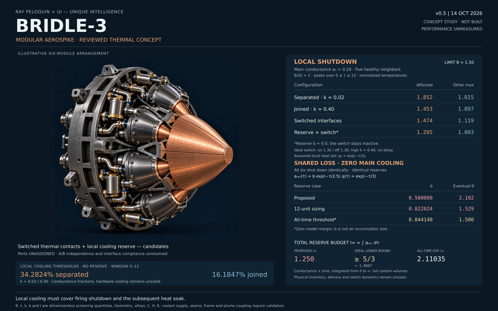
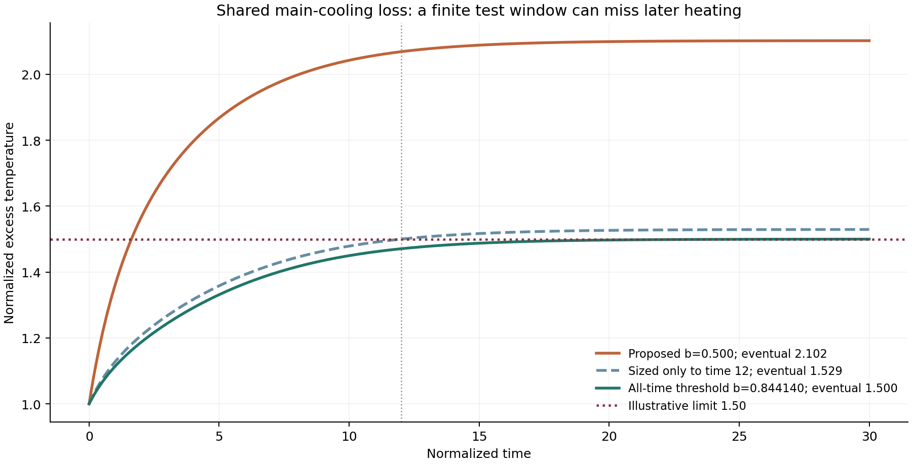

# BRIDLE-3 — Modular Aerospike Concept

**Concept study v0.5 · 14 October 2026 · Not built · Performance unmeasured**

Ray Peloquin + **UI — Unique Intelligence**

BRIDLE-3 explores six replaceable hot modules on a shared cooled frame, with
candidate temperature-actuated thermal contacts and local reserve cooling.
The figures and tables show how the model responds to assumed heat loads and
cooling faults. The simulation has yet to be calibrated against engine tests.

## How to read the numbers

The temperature values are dimensionless ratios. Divide the temperature
difference between a module and its coolant by that difference at startup.
On this scale, **1.00** is the starting value, and **1.50** is the comparison
limit chosen for this study.

In the “Local reserve only” row, the calculated peak of **1.205** means the
temperature difference grew by **about 20.5%**. Converting that peak to a
module temperature in degrees would require the coolant temperature and
starting temperature difference for the hardware.
[Normalization equations](BRIDLE-Thermal-Review-v0.5.md#2-dimensional-balance-and-normalization)



<a name="the-question"></a>

## Where does heat go after shutdown?

When one module shuts down with part of its main cooling still working, its
five cooled neighbors can absorb some of its heat. Joining the modules lowers
the affected peak and raises the highest neighboring peak. Adding local
reserve cooling keeps the affected module below the chosen limit during the
simulated window.

When all six shut down and lose all main cooling together, identical modules
with identical reserves stay equally hot. No net heat moves between neighbors.
With the same reserve per module, all six eventually exceed the chosen limit
as residual heat continues to arrive.

<a name="relevant-numbers"></a>

## Modeled temperatures and cooling reserves

Time also uses a relative scale. One model time unit equals the module’s heat
capacity divided by its nominal cooling conductance. Values for those two
properties are needed to translate a duration into seconds.

### One module shuts down; five remain healthy

The affected module retains **20% of its nominal main cooling conductance**.
The five healthy modules keep their normal heat input and cooling. The table
shows the highest temperature rises the model calculates over the first
12 model time units.

| Assumed cooling setup | Affected peak (× initial rise) | Highest other peak (× initial rise) |
|---|---:|---:|
| Separated, `k = 0.02` | 1.852 | 1.015 |
| Joined, `k = 0.40` | 1.453 | 1.097 |
| Ideal switched interfaces | 1.474 | 1.119 |
| Local reserve only | 1.205 | 1.003 |
| Ideal switches plus local reserve | 1.205 | 1.003 |

The last two rows match because reserve cooling keeps the modeled peak below
the switch threshold of 1.35. The reserve accounts for the improvement in
this case.

<details>
<summary>Single-module assumptions, switch settings and conductance thresholds</summary>

The affected module has `a0 = 0.20` and residual heat `q0 = exp(-tau/3)`.
The five healthy modules retain `q = a = 1`. The coefficient `k` measures heat
sharing between neighbors relative to nominal main cooling conductance.
Each switched interface closes when its hotter endpoint reaches 1.35 and opens
at 1.30, switching between `k = 0.02` and `0.40`. The switch acts instantly
in both directions, with the same conductance for heat flowing either way.
The reserve adds `0.5 exp(-tau/2.5)` to the affected module’s cooling conductance.

Without a reserve, the minimum retained conductance for the affected module
to stay within the limit over this window is **34.2824%** at `k = 0.02`, versus
**16.1847%** at `k = 0.40`. These are conductance fractions, not coolant-flow
fractions or hardware requirements.

</details>

### Shared loss of all main cooling

The table gives each module’s long-run temperature rise for three assumed
reserves. The coefficient `b` sets the initial reserve cooling conductance
relative to nominal main cooling. Estimating a coolant volume would also
require a model of coolant storage and delivery.

| Reserve case | Initial conductance coefficient `b` | Calculated long-run rise (× initial) | Compared with the chosen 1.50 limit |
|---|---:|---:|---|
| Original proposal | 0.500000 | 2.102392 | Exceeded |
| Sized only to `tau = 12` | 0.822024 | 1.529371 | Exceeded later |
| All-time model threshold | 0.844140 | 1.500000 | Approaches limit from below, zero model margin |



The dashed curve meets the limit at model time 12, then keeps rising toward
1.529. Stopping the calculation at 12 would miss that later heating.

<details>
<summary>Shared-loss equation and reserve budget</summary>

With identical modules and reserves, residual heat warms each module while
reserve cooling carries heat away.

$$
\frac{d\theta}{d\tau}=e^{-\tau/3}-b e^{-\tau/2.5}\theta,
\qquad \theta(0)=1.
$$

Integrating the reserve’s cooling conductance over time gives a dimensionless
budget equal to 2.5 times its starting coefficient, `b`.

$$
I_\infty=\int_0^\infty a_{\rm reserve}(\tau)\,d\tau=2.5b.
$$

The original exponential gives **1.250**. The all-time exponential threshold
gives **2.11035**. For this shared, zero-main-cooling problem with no other sink,
any admissible schedule must satisfy the ideal lower bound **`I >= 5/3`**.
These are finite mathematical totals over all future time, not coolant masses
or volumes. The reviewed note states their assumptions and derivations.

</details>

## Explore and reproduce

- [Thermal model assumptions, equations and requirements (Markdown)](BRIDLE-Thermal-Review-v0.5.md)
- [Reference thermal model and checks (Python script)](thermal_model.py)
- [Thermal model check results (JSON)](model-results.json)
- [Offline thermal model explorer (HTML)](BRIDLE-Thermal-Lab-v0.5.html) — download the raw HTML and open it locally; GitHub displays source rather than running it.
- [Complete thermal study (ZIP)](BRIDLE-Thermal-Study-v0.5.zip), including report generator, data, figures and optional browser checks.

With Python 3.11 or newer:

```bash
python -m pip install -r requirements.txt
python thermal_model.py
```

The model runs its consistency checks and writes a new `results/` directory
containing JSON, CSV trajectories and the reserve comparison plot. After that,
check the actual explorer JavaScript with a modern Node.js:

```bash
node qa_js_model.cjs
```

The numerical checks cover reciprocal flux conservation, exact shared-loss
solutions, a matrix-exponential comparison, switch-step convergence and the
remaining heat after reserve cutoff. The JavaScript harness checks all eight
reference cases, controls, warnings and CSV export. It does not establish
real-browser layout or rendering quality.

## What remains open

Measured heat capacities and conductances; finite coolant inventory and delivery;
A/B supply independence; valve and switch faults; seam sealing, thermal growth
and frame mechanics; wall gradients and coupled plume heating.

The illustration is a concept visualization. Ports are unassigned, candidate
reserves are unscaled, and materials and interfaces remain proposals. Neither
the image nor the screening model establishes a built engine, hardware safety,
thrust, specific impulse, an equal-mass advantage or a larger validated operating
envelope. No third-party endorsement is implied.

**Local cooling must cover shutdown and subsequent heat soak.**
