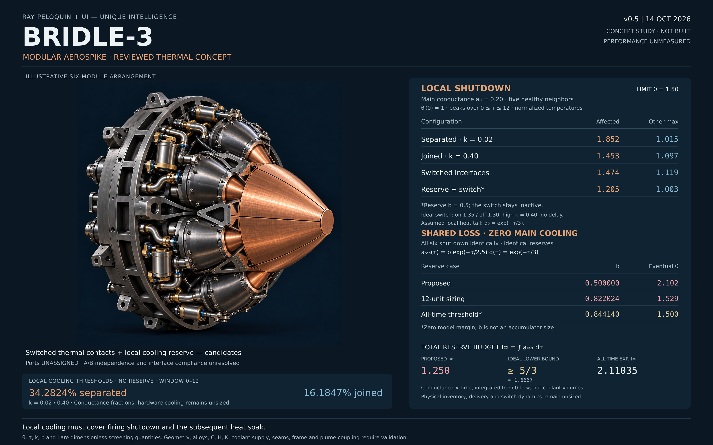
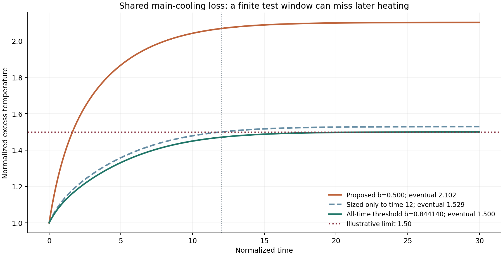

# BRIDLE-3 — Modular Aerospike Concept

**Concept study v0.5 · 14 October 2026 · Not built · Performance unmeasured**

Ray Peloquin + **UI — Unique Intelligence**

BRIDLE-3 explores six replaceable hot modules on a shared cooled frame, with
candidate temperature-actuated thermal contacts and local reserve cooling.
This repository pairs the concept illustration with a reproducible,
dimensionless thermal screening study.



## The question

When a module shuts down and loses cooling, where does the remaining heat go?
Reducing heat sharing protects neighboring modules but raises the affected
module's temperature. A reserve that helps one module can still fail when all
six lose main cooling together. The calculation must follow the residual heat
after shutdown, including the tail beyond a chosen simulation window.

## Relevant numbers

Every number below is a result of an **uncalibrated, dimensionless model**.
Temperature is normalized above a fixed coolant reference; these values are
neither degrees nor measured engine temperatures. The illustrative limit is
**1.50**.

### One module shuts down; five remain healthy

All modules start at 1. The affected module retains main cooling conductance
`a0 = 0.20`, with residual heat `q0 = exp(-tau/3)`. The five healthy modules retain
`q = a = 1`. Peaks cover `0 <= tau <= 12`.

| Configuration | Affected-module peak | Highest other-module peak |
|---|---:|---:|
| Separated, `k = 0.02` | 1.852 | 1.015 |
| Joined, `k = 0.40` | 1.453 | 1.097 |
| Ideal switched interfaces | 1.474 | 1.119 |
| Local reserve only | 1.205 | 1.003 |
| Ideal switches plus local reserve | 1.205 | 1.003 |

Each switched interface has one reciprocal conductance: it closes when the
hotter endpoint reaches 1.35 and opens at 1.30, switching between `k = 0.02` and
`0.40`. Response is instantaneous in this model. The reserve adds
`0.5 exp(-tau/2.5)` to the affected module's cooling conductance.

**The reserve keeps the temperature below the switch threshold, so the switch
does not activate in that case.** Its improvement comes from the modeled
reserve cooling.

Without a reserve, the minimum retained conductance for the affected module
to stay within the limit over this window is **34.2824%** at `k = 0.02`, versus
**16.1847%** at `k = 0.40`. These are conductance fractions, not coolant-flow
fractions or hardware requirements.

### Shared loss of all main cooling

All six modules shut down identically and receive identical reserves. Their
temperatures stay equal, so internal coupling cancels exactly:

$$
\frac{d\theta}{d\tau}=e^{-\tau/3}-b e^{-\tau/2.5}\theta,
\qquad \theta(0)=1.
$$

| Exponential reserve | Coefficient `b` | Eventual temperature | All-time limit 1.50 |
|---|---:|---:|---|
| Original proposal | 0.500000 | 2.102392 | Exceeded |
| Sized only to `tau = 12` | 0.822024 | 1.529371 | Exceeded later |
| All-time model threshold | 0.844140 | 1.500000 | Boundary; zero model margin |

The finite-window case reaches 1.50 at time 12 but exceeds it later.
**`b` is a dimensionless conductance coefficient, not an accumulator volume.**



The integrated conductance-time budget is

$$
I_\infty=\int_0^\infty a_{\rm reserve}(\tau)\,d\tau=2.5b.
$$

The original exponential gives **1.250**. The all-time exponential threshold
gives **2.11035**. For this shared, zero-main-cooling problem with no other sink,
any admissible schedule must satisfy the ideal lower bound **`I >= 5/3`**.
These are finite mathematical totals over all future time, not coolant masses
or volumes. The reviewed note states their assumptions and derivations.

## Explore and reproduce

- [Reviewed mathematics, definitions and requirements](BRIDLE-Thermal-Review-v0.5.md)
- [Python reference model](thermal_model.py)
- [Machine-readable checked results](model-results.json)
- [Offline interactive explorer](BRIDLE-Thermal-Lab-v0.5.html) — download the raw HTML and open it locally; GitHub displays source rather than running it.
- [Complete study ZIP](BRIDLE-Thermal-Study-v0.5.zip), including report generator, data, figures and optional browser checks.

With Python 3.11 or newer:

```bash
python -m pip install -r requirements.txt
python thermal_model.py
```

The model runs its consistency checks and writes a new `results/` directory
containing JSON, CSV trajectories and the reserve comparison plot. After that,
check the actual explorer JavaScript with a modern Node.js:

```bash
node qa_js_model.cjs
```

The numerical checks cover reciprocal flux conservation, exact shared-loss
solutions, a matrix-exponential comparison, switch-step convergence and the
remaining heat after reserve cutoff. The JavaScript harness checks all eight
reference cases, controls, warnings and CSV export. It does not establish
real-browser layout or rendering quality.

## What remains open

Measured heat capacities and conductances; finite coolant inventory and delivery;
A/B supply independence; valve and switch faults; seam sealing, thermal growth
and frame mechanics; wall gradients and coupled plume heating.

The illustration is a concept visualization. Ports are unassigned, candidate
reserves are unscaled, and materials and interfaces remain proposals. Neither
the image nor the screening model establishes a built engine, hardware safety,
thrust, specific impulse, an equal-mass advantage or a larger validated operating
envelope. No third-party endorsement is implied.

**Local cooling must cover shutdown and subsequent heat soak.**
